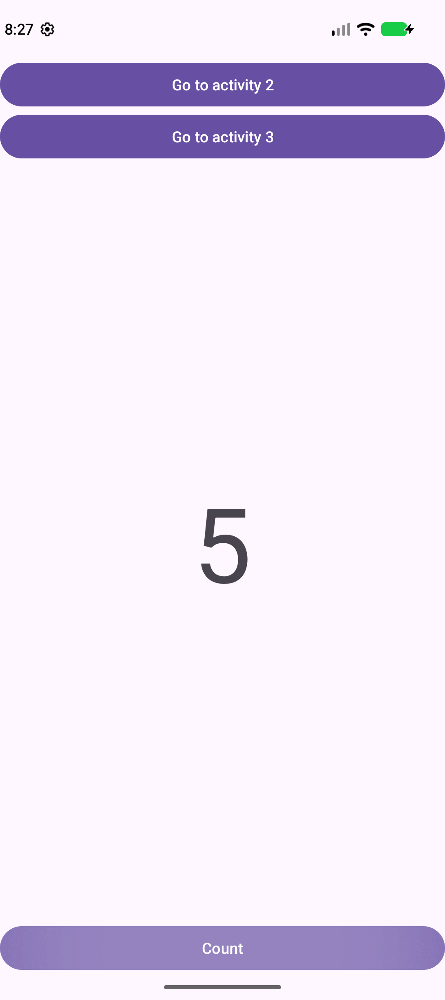
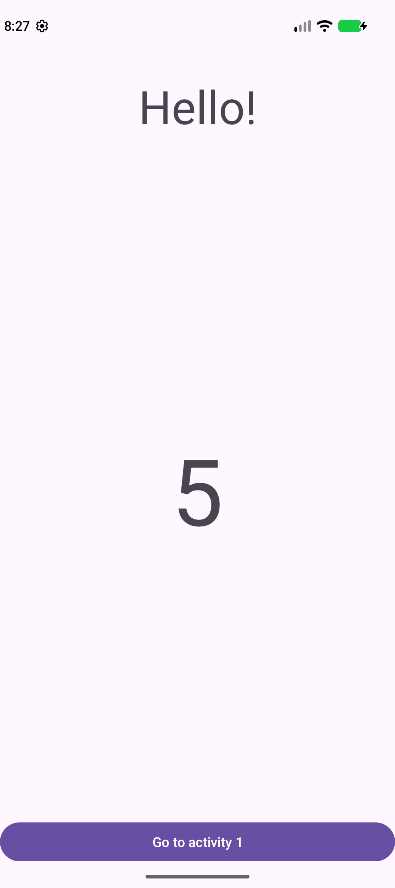
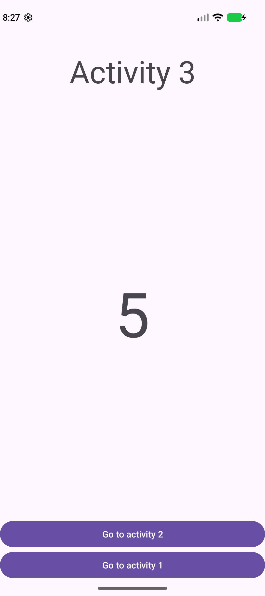

# Multiple Activities Application

A simple Android app built for a school assignment on activities, explicit intents, and gesture navigation. Increase a counter on the main screen and view its current value on two additional screens.

## Screenshots

| Main screen | Hello screen | Third screen |
| :---: | :---: | :---: |
|  |  |  |

## Features

- Increase the counter with the **Count** button.
- Open the second or third activity from the main screen.
- Display **Hello!** and the current counter value on the second screen.
- Display **Activity 3** and the current counter value on the third screen.
- Navigate from the third screen using buttons or horizontal swipes across the central counter area:
  - **Swipe left:** return to the main screen.
  - **Swipe right:** open the second screen.
- Return to the existing main activity without resetting its counter.
- Preserve the counter when the device rotates.

## Built with

- Java and XML layouts
- AndroidX AppCompat and Material Components
- Explicit `Intent` navigation with `putExtra()` and `getIntExtra()`
- `GestureDetector` for swipe navigation

**Minimum Android version:** Android 7.0 (API 24). Compile and target SDK: API 37.

## Getting started

1. Clone this repository or download and extract its ZIP file.
2. Open the project folder in Android Studio.
3. Install Android SDK Platform 37 through SDK Manager if needed.
4. Allow Gradle to sync and download the project dependencies.
5. Choose an emulator or connect an Android device with USB debugging enabled.
6. Run the **app** configuration.

Use Android Studio's bundled JDK for Gradle. The Android SDK location is configured locally in `local.properties`; do not commit your machine-specific SDK path.

## Build from the command line

On Windows:

```powershell
.\gradlew.bat assembleDebug
.\gradlew.bat lintDebug
```

On macOS or Linux:

```bash
./gradlew assembleDebug
./gradlew lintDebug
```

The debug APK is generated at `app/build/outputs/apk/debug/app-debug.apk`.

## Project structure

```text
app/src/main/
├── AndroidManifest.xml
├── java/com/example/multipleactivitiesapplication/
│   ├── MainActivity.java          # Counter and primary navigation
│   ├── SecondActivity.java        # Hello message and received counter
│   ├── ThirdActivity.java         # Counter, buttons, and swipe navigation
│   └── OnSwipeTouchListener.java  # Horizontal gesture detection
└── res/
    ├── layout/                    # Layouts for all three activities
    └── values/strings.xml         # Interface text
```

## Try it out

1. Tap **Count** several times.
2. Open activity 2 and confirm the counter matches the main screen.
3. Return to activity 1 and confirm the counter is unchanged.
4. Open activity 3 and check its counter value.
5. Try both navigation buttons and both swipe directions on activity 3.
6. Rotate the device and confirm the counter is preserved.

## Assignment context

Created for **Mobile Application Development - Assignment 5: Working with Multiple Activities**. The project demonstrates sharing data between activities and combining button navigation with touch gestures.
